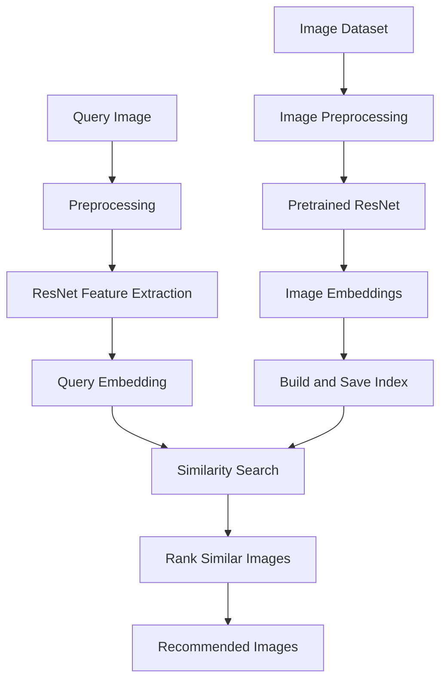

# 🖼️ Visual Similarity Based Image Recommendation System

**An AI-powered image recommendation system that finds visually similar images using Deep Learning and Computer Vision.**

## 📌 Overview

The **Visual Similarity Based Image Recommendation System** uses deep learning to understand the visual characteristics of images and recommend other images that look similar.

Instead of relying on image names, tags, or textual descriptions, the system extracts meaningful visual features such as shapes, textures, colors, and object patterns. These features are represented as numerical vectors called **image embeddings**, which are compared to identify visually similar images.

The project uses a ResNet-based feature extraction approach and similarity search to retrieve relevant image recommendations from an image collection.

## 🎯 Objectives

- Build an intelligent image recommendation system using Computer Vision.
- Extract meaningful visual features from images using a pretrained CNN.
- Represent images as numerical feature vectors or embeddings.
- Calculate similarity between images using vector comparison.
- Retrieve and recommend images based on visual resemblance.
- Explore practical applications of deep learning and image retrieval.

## ✨ Key Features

- **Deep Learning Feature Extraction:** Use a pretrained ResNet model to extract high-level image representations.
- **Image Embeddings:** Convert images into numerical vectors that capture their visual characteristics.
- **Visual Similarity Search:** Compare image embeddings to find similar images.
- **Image Recommendations:** Retrieve visually related images for a given query image.
- **Reusable Index:** Build and save a feature index to avoid extracting features from the entire dataset every time.
- **Scalable Design:** Separate index-building and similarity-search logic for easier maintenance and future improvements.

## ⚙️ How It Works

The system follows a deep learning-based image retrieval pipeline.

1. **Image Collection:** Load images from the dataset.
2. **Preprocessing:** Resize images and normalize them according to the pretrained model's requirements.
3. **Feature Extraction:** Pass each image through a pretrained ResNet model to obtain a feature vector.
4. **Index Building:** Store the extracted feature vectors and corresponding image metadata for efficient retrieval.
5. **Query Image:** Select or provide an image for which recommendations are required.
6. **Similarity Calculation:** Compare the query image's feature vector with the indexed image vectors.
7. **Ranking:** Rank candidate images by their similarity scores.
8. **Recommendation:** Return the top matching images.

### Architecture



## 🧠 Technologies Used

| Technology | Purpose |
|---|---|
| Python | Core programming language |
| PyTorch | Deep learning model execution |
| ResNet | Visual feature extraction |
| Torchvision | Image transformations and pretrained models |
| NumPy | Numerical operations on feature vectors |
| FAISS (if configured) | Efficient vector similarity search |
| tqdm | Progress bars during index construction |
| Git and GitHub | Version control and project hosting |

## 📁 Project Structure

The following is an illustrative structure. Keep the filenames and folders consistent with your actual repository.

```text
visual_similarity_based_image_recommendation_system/
│
├── data/
│   └── images/                  # Image dataset
│
├── src/
│   └── similarity.py            # Similarity search logic
│
├── build_index.py               # Extract features and build index
├── requirements.txt             # Python dependencies
├── .gitignore                   # Files excluded from Git
└── README.md                    # Project documentation
```

Generated indexes, metadata, and model files may be stored in additional folders depending on your implementation.

## 🚀 Installation and Setup

### Prerequisites

Make sure you have the following installed:

- Python 3.10 or another version supported by your dependencies
- Git
- Visual Studio Code (recommended)
- A compatible PyTorch installation

### Step 1: Clone the Repository

```bash
git clone https://github.com/Shikha09456/visual_similarity_based_image_recommendation_system.git
```

Navigate to the project directory:

```bash
cd visual_similarity_based_image_recommendation_system
```

### Step 2: Create a Virtual Environment

On Windows:

```bash
python -m venv venv
```

Activate the environment in Command Prompt:

```bash
venv\Scripts\activate
```

Or in PowerShell:

```powershell
.\venv\Scripts\Activate.ps1
```

### Step 3: Install Dependencies

If the repository contains a `requirements.txt` file:

```bash
python -m pip install --upgrade pip
pip install -r requirements.txt
```

If dependencies are not yet listed, install the packages required by the implementation:

```bash
pip install torch torchvision numpy pillow tqdm faiss-cpu
```

**Note:** PyTorch installation can depend on your operating system and whether you use a CPU or compatible NVIDIA GPU. If needed, follow the official [PyTorch installation guide](https://pytorch.org/get-started/locally/).

## ▶️ Running the Project

### Step 1: Prepare the Dataset

Place your image dataset in the configured image directory. Ensure that the dataset path in the index-building script matches your actual folder structure.

### Step 2: Build the Image Index

Run the feature extraction and indexing script:

```bash
python build_index.py
```

This step should extract image features and save the index and associated metadata according to your implementation.

Run it again when you add new images or need to rebuild the index.

### Step 3: Perform Similarity Search

Use the similarity-search functionality implemented in `src/similarity.py` or the project's configured entry-point script to provide a query image and retrieve its nearest matches.

For example, the intended workflow is:

```python
# Conceptual example: adapt the function names
# and arguments to your implementation.

query_image = "path/to/query_image.jpg"

# Extract the query image's embedding.
# Search the saved index.
# Retrieve and display the top similar images.
```

The exact function call depends on the functions exposed by your implementation.

## 🔍 Understanding Image Similarity

A pretrained ResNet learns hierarchical visual representations. Earlier layers capture relatively simple patterns, while deeper layers represent more complex visual information.

The extracted feature vector can be compared with vectors from other images.

One common similarity measure is **cosine similarity**:

\[
\operatorname{cosine}(A,B)=
\frac{A\cdot B}{\|A\|\|B\|}
\]

Where:

- \(A\) is the query image's feature vector.
- \(B\) is a candidate image's feature vector.
- \(A\cdot B\) is their dot product.
- \(\|A\|\) and \(\|B\|\) are their vector magnitudes.

For normalized embeddings, cosine similarity ranges from -1 to 1. Higher values indicate more similar vector directions.

If FAISS is used, the search operation can retrieve nearest vectors efficiently. The interpretation of returned scores depends on the configured index and distance metric.

## 📊 Potential Applications

- E-commerce product recommendations
- Fashion and clothing discovery
- Similar product image search
- Digital image libraries
- Visual content discovery
- Image deduplication and near-duplicate detection

## ⚡ Future Improvements

- Add an interactive Streamlit interface for uploading query images.
- Display the top-k recommended images with similarity scores.
- Support larger datasets with optimized vector indexes.
- Compare ResNet embeddings with EfficientNet or Vision Transformer embeddings.
- Add image filtering by category or metadata.
- Evaluate retrieval quality using Precision@K, Recall@K, and mean Average Precision (mAP).
- Deploy the application as a web-based image recommendation service.

## ⚠️ Limitations

- Visually similar images are not necessarily semantically identical.
- Results depend on the pretrained model, preprocessing pipeline, and similarity metric.
- Domain-specific datasets may benefit from fine-tuning.
- Indexing large image collections requires additional memory and processing time.
- Recommendation quality should be evaluated on a representative dataset rather than assumed from similarity scores alone.

## 🤝 Contributing

Contributions and suggestions are welcome.

1. Fork the repository.
2. Create a feature branch.
3. Make your changes.
4. Test your implementation.
5. Submit a pull request describing your improvements.

## 👩‍💻 Author

**Shikha Kumari**

GitHub: [@Shikha09456](https://github.com/Shikha09456)

## 📄 License

A license has not yet been specified. If you intend to make this project open source, consider adding an appropriate license file, such as the MIT License, after deciding on the usage and distribution terms.

---

⭐ If you find this project useful, consider starring the repository!
